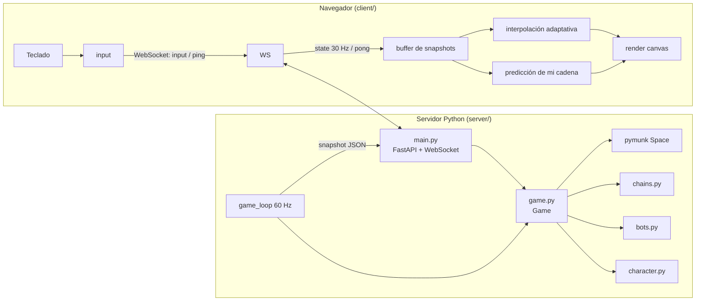
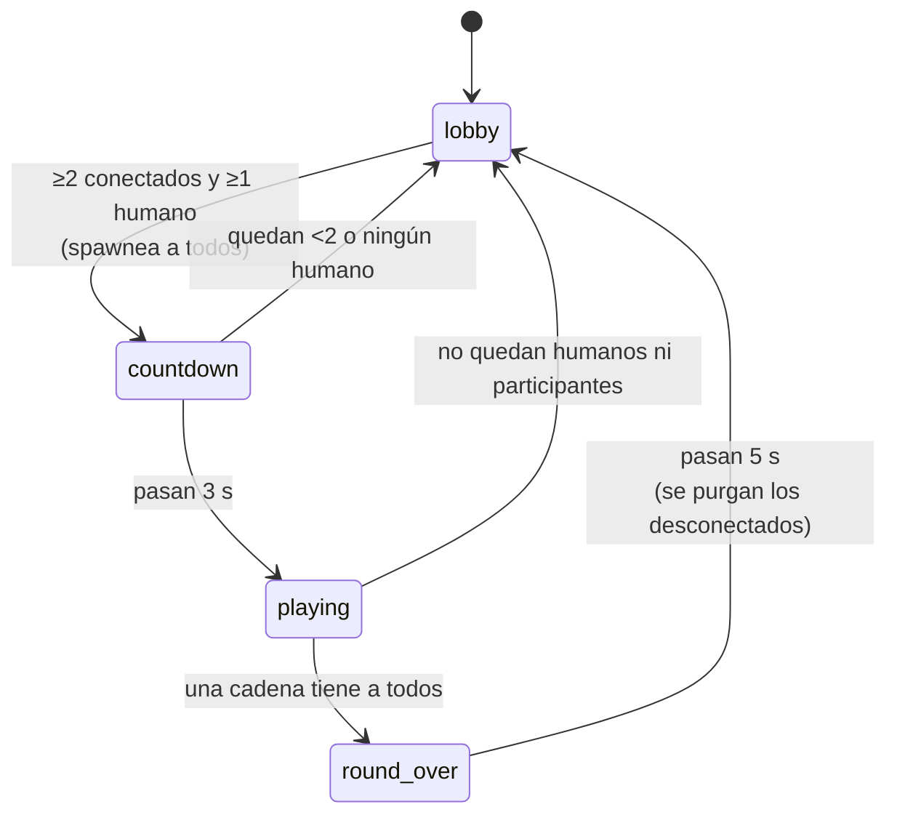
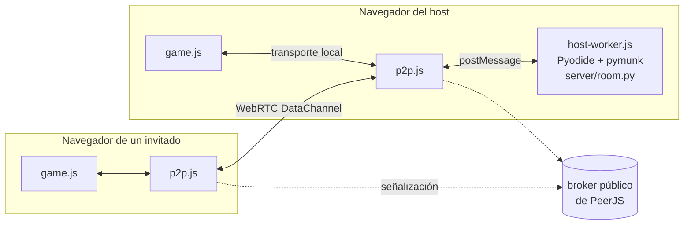

# Arquitectura de Dicknbutt

Juego multijugador 2D top-down en el navegador. Cada jugador maneja la cabeza de un pene con un tronco flexible y dos testículos. Si metés la punta entre los testículos de otro (por detrás, alineado y con velocidad), pasás a manejar su cuerpo y el tuyo queda enganchado atrás. Gana quien maneja la cadena cuando todos los jugadores están adentro.

## 1. Visión general



- **Servidor autoritativo**: toda la física, las reglas, los bots y las colisiones viven en Python. El cliente nunca decide nada del juego.
- **Cliente liviano**: manda teclas, recibe el estado y lo dibuja. Para que no se note la latencia, interpola a los demás y predice la cadena que maneja él.
- **Una sola sala**, hasta 8 jugadores contando bots.
- **Dos formas de correrlo**: con el servidor Python (FastAPI + WebSocket) o en **GitHub Pages sin servidor**, donde el navegador de quien crea la sala corre el mismo Python con Pyodide y los demás se conectan por WebRTC (sección 15).

## 2. Archivos

| Archivo | Responsabilidad |
|---|---|
| `run.py` | Arranca uvicorn en `0.0.0.0:$PORT` (8765 por defecto). |
| `start.sh` / `stop.sh` | Levantan el juego en segundo plano (log en `game.log`) y lo bajan buscando el proceso que escucha en el puerto. |
| `server/config.py` | **Todos** los valores tuneables: anatomía, física, control, boost, hitbox, rondas, colores. |
| `server/main.py` | App FastAPI: sirve el cliente, endpoint WebSocket `/ws`, loop del juego, broadcast, lag simulado, timer de Windows. |
| `server/room.py` | `Room`: el protocolo de `/ws` y el loop de paso fijo sin red, para el host P2P. También `CLIENT_CONFIG`. |
| `server/game.py` | `Game` y `Player`: fases de ronda, entrada de jugadores, controles, boost, penetración, ganador, snapshot. No sabe nada de red. |
| `server/character.py` | `Character`: arma los cuerpos y joints de pymunk de un personaje, y el acople entre dos personajes. |
| `server/chains.py` | Reglas puras de cadenas (merge, desconexión, ganador). No usa pymunk. |
| `server/arena.py` | Paredes y pilares estáticos. |
| `server/bots.py` | IA de los bots: decide qué teclas aprieta cada bot. |
| `client/index.html` | Pantalla de nombre, canvas y paneles del HUD (estilos inline). |
| `client/game.js` | Conexión, input (teclado y táctil), interpolación, predicción, render y HUD. Vanilla JS, sin build. |
| `client/p2p.js` | Solo en GitHub Pages: crear o unirse a una sala, PeerJS y un transporte con la interfaz de WebSocket. |
| `client/host-worker.js` | Solo en GitHub Pages: Web Worker que carga Pyodide + pymunk y corre `Room`. |
| `tools/build_pages.py` | Arma `_site/` para Pages. Lo corre `.github/workflows/pages.yml`. |
| `tests/` | `test_chains.py` (reglas), `test_sim.py` (física headless), `test_bots.py` (IA y bots). |

## 3. El loop del servidor

`main.game_loop()` corre en el event loop de asyncio con **paso fijo**:

1. Calcula cuántos ticks de `1/60 s` se deben y los corre todos (si se atrasó más de 250 ms, descarta el atraso en vez de ponerse al día).
2. Cada `BROADCAST_EVERY = 2` ticks arma un snapshot y lo manda a todos los sockets (**30 Hz**).
3. Duerme hasta el próximo tick.

En Windows, `lifespan` llama a `timeBeginPeriod(1)` al arrancar: sin esto los sleeps se despiertan cada ~15,6 ms y los snapshots llegaban con ±5 ms de variación (picos de 49 ms). Con esto quedan en ±0,6 ms.

Todo corre en un solo hilo (el event loop), así que los handlers de WebSocket y el loop del juego nunca tocan el estado al mismo tiempo.

### Un tick (`Game.step`)

```
_update_phase(dt)          fases de ronda (sección 7)
bots.think()               los bots eligen teclas (solo en playing / round_over)
2 subpasos:
    _apply_controls()      fuerzas y giros (se re-aplican porque pymunk las resetea en cada step)
    space.step(dt / 2)
_clamp_speeds()            tope de seguridad a 1400 px/s para que nada explote
_check_penetrations()      solo en playing
_check_winner()            solo en playing
```

## 4. El personaje (`character.py`)

Marco local de cada cuerpo: **+x apunta hacia adelante**. La pantalla tiene y hacia abajo, así que un ángulo positivo gira en sentido horario.

Todos los personajes son iguales (medidas en `config.py`):

```
  cabeza      tronco: 6 segmentos de 20 px              base     bolas
   (●)═[seg0]═[seg1]═[seg2]═[seg3]═[seg4]═[seg5]  ⟨● ●⟩
   r=13                     r=9                           r=12
```

| Pieza | Cuerpo pymunk | Unión |
|---|---|---|
| Cabeza | `Circle` r=13, masa 1 | `PivotJoint` al primer segmento |
| Tronco | 6 `Segment` de 20 px, r=9, masa 0,6 c/u | `PivotJoint` + `DampedRotarySpring` (rigidez 800) + `RotaryLimitJoint` (±65° por articulación) |
| Testículos | 2 `Circle` r=12, masa 0,35 | `DampedSpring` hacia su posición de reposo + `SlideJoint` (máx 12 px): se bambolean |

Puntos especiales en el marco local de la base (último segmento):

- **`TARGET_LOCAL`**: el hueco entre las bolas. Es la zona objetivo.
- **`COUPLE_LOCAL`**: donde queda clavada la cabeza del conquistador.

**Ángulos sin envolver.** pymunk no envuelve los ángulos (pueden valer 7π). Por eso `add_bend_joints` calcula el múltiplo de 2π más cercano (`_rel_turns`) y lo usa como reposo del resorte. Si no, un acople entre cuerpos con vueltas distintas haría girar todo.

**Colisiones.** Todas las shapes de una cadena comparten `ShapeFilter(group=chain_id)`: dentro de la cadena nada choca entre sí (evita trabas en las uniones), y contra el resto todo es sólido. Efecto secundario: un pene puede enrollarse sobre sí mismo.

## 5. Cadenas (`chains.py`)

```python
Chain(id, members=[frente, ..., fondo], pilot)
```

- El **piloto** maneja la cabeza de `members[0]`.
- Solo los testículos de `members[-1]` están libres para ser penetrados.

| Situación | Resultado |
|---|---|
| A (sola) penetra a B (sola) | `[B, A]`, piloto A. A maneja el cuerpo de B; su cuerpo queda atrás. |
| C penetra la cola de `[B, A]` | `[B, A, C]`, piloto C: se queda con toda la cadena. |
| `[B, A]` (piloto A) penetra `[E, F]` | `[E, F, B, A]`, piloto A. |
| Se desconecta el piloto | El control pasa al conectado más cercano al **final** de la cadena. Si no queda nadie conectado, la cadena queda inerte (sin piloto). |
| Ganador | La cadena con piloto que contiene a **todos los jugadores conectados**. |

Los jugadores desconectados que estaban en una cadena quedan como vagón pasivo hasta que termina la ronda. Si estaban solos, su cuerpo se borra.

## 6. Penetración (`Game._check_penetrations`)

En cada tick, para cada cadena con piloto (atacante X) y cada otra cadena (víctima Y), la cabeza frontal de X conquista a Y si:

1. está a menos de `ENTRY_RADIUS` (34 px) del `target_point()` del último de Y,
2. el ángulo entre su dirección y la de la base de Y es menor a `ENTRY_ANGLE` (35°): tiene que venir **por detrás**,
3. la velocidad de cierre (velocidad relativa proyectada sobre la dirección de la víctima) supera `ENTRY_MIN_SPEED` (90 px/s).

Si no se cumplen, simplemente chocan: las bolas son sólidas y la cabeza rebota.

**Por qué es una verificación geométrica y no un callback de colisión:** es determinística, no depende del orden de los callbacks de pymunk, se puede testear fácil, y la modificación del `Space` (agregar joints) se hace fuera del `space.step`.

**El acople (`_couple` + `Character.couple_to`):**

- se agrega un `PivotJoint` entre la cabeza del atacante y `COUPLE_LOCAL` de la víctima, con `max_bias = 260 px/s` para que la cabeza "entre" suave en vez de teletransportarse;
- se agrega un resorte de doblez más blando (±45°);
- todas las shapes del atacante pasan al `group` de la víctima;
- `chains.merge` actualiza la cadena;
- se emite un evento `conquest`.

Si en un mismo tick hay varias penetraciones, cada cadena participa en una sola.

## 7. Fases de ronda



- **Spawn**: los jugadores se reparten en una elipse (radios 900 × 560) alrededor del centro, mirando al centro.
- **Entrar a mitad de ronda**: en `countdown` se re-spawnea a todos para incluirte; en `playing` o `round_over` quedás de espectador (`spectator: true`) hasta la próxima.
- En `countdown` la física corre pero los controles no. En `round_over` sí hay controles (el ganador puede dar una vuelta olímpica), pero no hay más conquistas.
- **Sin humanos conectados**, los bots esperan en el lobby.

## 8. Controles (`Game._apply_controls`)

**Piloto** (sobre la cabeza frontal de su cadena):

- **Giro** (←/→): la velocidad angular se lleva hacia ±4,2 rad/s (mezcla 0,35 por subpaso). Sin teclas se frena ×0,9 por subpaso.
- **Empuje** (↑): fuerza de `2600 × (1 + 0,55 × (n−1))` en la dirección de la cabeza, donde n es el largo de la cadena. Como la masa crece más que el empuje, **las cadenas largas son más lentas** y vulnerables.
- **Tope de velocidad**: 420 px/s. Si se pasa (por ejemplo al terminar un boost), baja suave (×0,85 por subpaso del exceso), no de golpe.

**Conquistado** (sobre su propia cabeza, que está clavada en el de adelante): sus teclas aplican una fuerza del 20 % del empuje (↑ hacia adelante, ←/→ hacia los costados). Es el **sabotaje**: tironea, pero no puede soltarse.

**Boost** (espacio):

- Se activa en el flanco de subida de la tecla: mantenerla apretada no lo repite.
- Dura 0,3 s, tiene 3 s de cooldown y solo funciona en `playing` y `round_over`.
- Piloto: empuje ×4 (aunque no apriete ↑) y tope de velocidad ×1,7. En la práctica va de ~430 a ~850 px/s.
- Conquistado: tirón de sabotaje ×4.

## 9. Bots (`bots.py`)

Los bots son `Player` con `bot=True`. No tienen socket: en cada tick `bots.think()` les escribe `p.input` como si apretaran teclas. Así usan exactamente el mismo camino que un humano y no hacen trampa con la física.

- **Reacción**: cada bot re-decide cada 4 ticks (~67 ms), con un desfase distinto por bot.
- **Elección de presa**: la cola libre con menor `distancia × (1 + velocidad/350)`. Prefiere presas cercanas y lentas.
- **Aproximación**: apunta a un punto **detrás** de la cola, a `min(130, 0.6 × distancia)`, así llega alineado; anticipa 0,25 s el movimiento de la víctima. Si está al costado o adelante, rodea por el lado donde ya está. El punto se mantiene a ≥45 px de las paredes.
- **Estocada final**: si ya está detrás y dentro del cono, va directo al hueco y usa el boost a menos de 220 px.
- **Esquiva**: mira 60 y 120 px adelante; si hay pared u obstáculo (y el objetivo no está más cerca), gira hacia el lado libre. En la estocada final no esquiva.
- **Paciencia**: si en 5 s no se acercó 40 px a su presa, hace una finta al azar (0,5–1,3 s), ignora esa presa durante 5 s y busca otra. Sin esto, dos bots se perseguían la cola en círculo para siempre.
- **Conquistado**: tironea hacia un lado al azar, cambia cada 0,25–0,8 s y de vez en cuando usa el boost.
- **Chat**: cuando a un bot lo conquistan, conquista o gana, `bots.react()` tira la moneda (50 %) y programa una frase de `LINES` («No, la cola no ahh.», «atrodeeen»…) para 0,4–1,5 s después, como si la escribiera. Un mismo bot no habla más de una vez cada 4 s y entre frases de cualquier bot pasan al menos 1,5 s. Las frases salen por `Game.chat`, igual que las de un humano.

Medido en simulación: 4 bots solos terminan 8 de 8 rondas en 15–95 s.

## 10. Red

### Protocolo WebSocket (`/ws`, JSON)

| Dirección | Mensaje | Cuándo |
|---|---|---|
| C → S | `{"t":"join","name"}` | Primer mensaje. Si la sala está llena: `error` y cierre. |
| C → S | `{"t":"input","l","r","u","b"}` (0/1) | Solo cuando cambia una tecla. |
| C → S | `{"t":"ping","c":<performance.now>}` | Cada 1 s. |
| C → S | `{"t":"add_bot"}` / `{"t":"remove_bot"}` | Botones `+` / `−`. |
| C → S | `{"t":"chat","text"}` | Mensaje de chat (Enter en la PC, 💬 en el celu). |
| S → C | `{"t":"welcome","id","arena","config","chat"}` | Una vez. `config` trae tamaños y las constantes que necesita la predicción; `chat`, los últimos 30 mensajes. |
| S → C | `{"t":"state", ...}` | 30 Hz (ver abajo). |
| S → C | `{"t":"pong","c"}` | Respuesta al ping, devuelve el mismo `c`. |
| S → C | `{"t":"error","msg"}` | Sala llena, etc. |

**Snapshot `state`**:

```jsonc
{
  "t": "state", "tick": 1234, "phase": "playing", "timer": 0, "winner": null,
  "players": [{ "id", "name", "color", "connected", "bot", "boost", "boosting", "chain", "spectator" }],
  "chains":  [{ "id", "members": ["p2", "p1"], "pilot": "p1" }],
  "chars": {
    "p1": {
      "h": [x, y, ang],        // cabeza
      "s": [[x, y, ang], ...], // segmentos
      "b": [[x, y], [x, y]],   // bolas
      "t": [x, y]              // zona objetivo, solo si es el último de su cadena
    }
  },
  "events": [{ "kind": "conquest" | "win" | "join" | "leave" | "chat", ... }] // opcional
}
```

Pesa ~1,7 KB con 4 jugadores. Se serializa una sola vez por broadcast y se manda a todos con `asyncio.gather`; los errores de envío se ignoran porque cada handler detecta su propia desconexión.

### Chat

El chat no tiene un mensaje propio de servidor a cliente: `Game.chat(pid, texto)` lo agrega como evento `{"kind":"chat","id","who","name","color","bot","text"}` y sale en el próximo snapshot (≤ 33 ms), en los dos modos. Lleva nombre y color para poder mostrarlo aunque el jugador ya se haya ido; `id` evita duplicados entre el historial del `welcome` y el snapshot siguiente.

- Se limpia (sin caracteres de control, `strip`) y se corta a 140 caracteres; vacío se descarta.
- Como mucho 3 mensajes cada 5 s por jugador (`CHAT_RATE_N`, `CHAT_RATE_S`); el resto se ignora en silencio.
- `Game.chat_log` guarda los últimos 30 para el que entra tarde.
- En el cliente, los mensajes aparecen en el feed (12 s) y en la caja de chat. Mientras escribís, las teclas del juego no se capturan y se sueltan las que estaban apretadas.

### Lag simulado

`SIM_LAG_MS=150 python run.py` (o `SIM_LAG_MS=150 ./start.sh`) demora la mitad a la ida (inputs y pings, con `call_later`) y la mitad a la vuelta (envíos). En Windows el lag real queda unos ~30 ms por debajo, porque asyncio dispara los timers hasta un tick de reloj antes.

## 11. Cliente (`client/game.js`)

### Pipeline de un frame

```
interpolatedChars()   → todos los personajes, dibujados net.delay ms en el pasado
predictOwnChain()     → reemplaza mi cadena por su versión "en el presente"
cámara                → sigue la cabeza que manejo (o la mía si me conquistaron; toda la arena si miro)
drawArena → zonas objetivo → cuerpos → bolas → estelas del boost → nombres → minimapa → medidor de boost
```

Las bolas se dibujan después de todos los cuerpos: así la cabeza acoplada queda "adentro".

### Interpolación adaptativa

Cada snapshot se guarda con su hora de llegada. Los demás se dibujan interpolando entre los dos snapshots que rodean `ahora − net.delay`.

`net.delay` se ajusta solo: `intervalo medio + 3 × variación`, acotado a 35–150 ms y cambiado de a poco. Con una conexión estable queda en ~45 ms.

### Predicción de la cadena propia

Solo cuando sos piloto y la ronda está en juego:

1. **Horizonte**: `ahead = tiempo desde el último snapshot + RTT` (máx 250 ms). Es cuándo van a verse en el servidor las teclas que apretás ahora.
2. **Cuerpo**: cada punto de mi cadena se extrapola linealmente desde los dos últimos snapshots (la velocidad se calcula con los números de tick, no con la hora de llegada).
3. **Cabeza**: `stepModel()` es una copia simplificada de `_apply_controls` (giro, empuje, damping, tope, boost) que corre con mis teclas locales. Las constantes llegan del servidor en `config`.
4. **Corrección**: la cabeza predicha se acerca a la posición del servidor extrapolada con constante de tiempo de 0,2 s. Si se separa más de 150 px, se descarta y salta a la del servidor.
5. El desplazamiento de la cabeza se reparte por el tronco, de 100 % cerca de la cabeza a ~0 % en la base, para que el cuerpo la acompañe sin estirarse.
6. Un suavizado de 30 ms esconde los saltos cuando llega un snapshot nuevo.

Resultado medido con ~120 ms de ping: la cabeza empieza a girar en pantalla a los ~70 ms de apretar la tecla, contra 220 ms sin predicción.

**Efecto secundario**: con ping alto, tu cadena se ve un poco adelantada respecto de los demás. Podés verte "entrar" en una cola un instante antes de que el servidor lo confirme; si no cuenta, se corrige sola.

### HUD

- **Arriba a la izquierda**: ping (verde < 80 ms, amarillo < 150 ms, rojo arriba de eso).
- **Arriba al centro**: estado de la ronda (esperando, cuenta regresiva, conquistado, ganador).
- **Arriba a la derecha**: cadenas en orden con 👑 en el piloto, y botones de bots.
- **Abajo**: medidor de boost, ayuda de controles, feed de eventos y minimapa.

### Controles táctiles

Se activan con `matchMedia("(pointer: coarse)")` o con el primer `touchstart` (clase `body.touch`). Teclado y táctil escriben el mismo `input` con `setInput()`, que manda un solo mensaje y solo si algo cambió, así que **el servidor y el protocolo no saben nada del celu**.

- **Joystick flotante** (mitad izquierda): la base aparece donde apoyás el dedo, con radio de 60 px. `steerFromStick()` corre en cada frame después de la predicción y traduce el stick a teclas:
  - rumbo actual: la cabeza que manejo (`cameraTarget`), que ya es la predicha;
  - deflexión ≥ 0,2: gira (`l`/`r`) hacia el ángulo del stick hasta quedar a menos de 0,1 rad, soltando antes según la velocidad angular (`STICK_LEAD_S`) para no pasarse;
  - deflexión ≥ 0,55: además empuja (`u`).

  Conquistado, la misma lógica tironea de costado hacia el stick. Medido: el rumbo converge a ~0,1 rad en 1,5 s con ~10 mensajes de input por segundo.
- **⚡** (abajo a la derecha): `b` mientras está apretado; el cooldown se dibuja con un `conic-gradient` (`--p`).
- Multitouch por `pointerId`: se puede girar y usar el boost a la vez, y soltar uno no suelta el otro.
- **Layout**: márgenes con `env(safe-area-inset-*)` por el notch; en pantallas chicas el panel de cadenas arranca colapsado, el feed sube y el minimapa va chico abajo al centro. En vertical aparece un aviso para girar el celu.
- **Otros**: DPR del canvas limitado a 2, inputs de 16 px (iOS no hace zoom), Wake Lock para que no se apague la pantalla, botón de pantalla completa (Android) y menú de compartir del sistema para el link de la sala.

## 12. Tuneo

Todo está en `server/config.py`. Los valores que más cambian la sensación del juego:

| Qué querés cambiar | Constante |
|---|---|
| Qué tan fácil es conquistar | `ENTRY_RADIUS`, `ENTRY_ANGLE`, `ENTRY_MIN_SPEED` |
| Flexibilidad del pene | `SHAFT_STIFFNESS` (menos = más blando), `SHAFT_MAX_BEND` (menos = no se enrolla) |
| Velocidad y manejo | `THRUST`, `MAX_SPEED`, `TURN_SPEED`, `SPACE_DAMPING` |
| Qué tan lentas son las cadenas largas | `CHAIN_THRUST_BONUS` |
| Boost | `BOOST_THRUST_MULT`, `BOOST_SPEED_MULT`, `BOOST_DURATION`, `BOOST_COOLDOWN` |
| Fuerza del sabotaje | `SABOTAGE_FACTOR`, `BOOST_SABOTAGE_MULT` |
| Dificultad de los bots | `REACTION_TICKS`, `PATIENCE_S`, `BOOST_RANGE` (en `bots.py`) |

La predicción del cliente lee las constantes de movimiento desde `config`, así que no hay que tocar el JS al cambiarlas.

## 13. Tests

```bash
pytest
```

- **`test_chains.py`**: merge, cadena contra cadena, desconexiones y ganador. Sin física.
- **`test_sim.py`**: física headless. Estabilidad, penetración desde atrás, rebote desde el costado o sin velocidad, desalineación tolerada, tercero que toma la cadena, piloto que se desconecta, reinicio, espectadores y boost con su cooldown.
- **`test_bots.py`**: lobby con bots, bots solos no juegan, un bot conquista a un humano quieto, un bot conquistado sabotea.

El helper `place()` de `test_sim.py` reubica personajes a mano en una zona sin obstáculos (y = 280) para armar escenarios.

La predicción y el render del cliente no tienen tests automáticos: se verificaron con Chrome headless por DevTools Protocol.

## 14. Operación

```bash
pip install -r requirements.txt
./start.sh            # levanta en segundo plano → http://localhost:8765
./stop.sh             # lo baja
ngrok http 8765       # para jugar con gente de afuera (el cliente usa wss:// solo si la página es https)
```

- **Puerto 8765**: el 8000 lo usa otra app de esta máquina.
- **Reiniciar el servidor desconecta a todos**: tienen que recargar la página. Si se recarga el cliente nuevo contra un servidor viejo, la predicción puede romperse porque le faltan campos de `config`.
- **Cierre del proceso**: `main.py` libera la física en un `atexit`, porque si pymunk se desmonta antes que el `Game` global, Python termina con segfault.

## 15. Modo P2P (GitHub Pages)



- **El mismo código Python.** `host-worker.js` baja Pyodide 314 (CDN de jsDelivr) y `pymunk==7.3.0` (PyPI publica un wheel para Pyodide), escribe los `.py` de `server/` (menos `main.py`) en el sistema de archivos virtual y crea un `Room`. La física da lo mismo que en CPython. Con 7 jugadores el worker sostiene 60 ticks/s.
- **`Room`** hace lo que hace `main.py` sin FastAPI: recibe `(conexión, texto)` y contesta con callbacks `send(conn, texto)` y `kick(conn)`. `tick(ahora)` corre los pasos de 1/60 s que se deben y devuelve el snapshot cada 2. El worker lo llama con `setTimeout` hasta `room.next_t`.
- **En un worker** para que la física no trabe el render del host y porque los timers de un worker no se frenan con la pestaña en segundo plano. Es un worker de tipo módulo: Chrome no deja usar `importScripts` con scripts de otro dominio.
- **Transporte.** `P2P.open(modo)` devuelve un objeto con la interfaz de WebSocket (`readyState`, `send`, `close`, `onopen`, `onmessage`, `onclose`), así que `game.js` no cambia: el protocolo de la sección 10 viaja igual. El host juega por un transporte local que habla directo con el worker (ping ~0 ms).
- **Salas.** El host registra el id `dicknbutt-v1-<CÓDIGO>` en el broker público de PeerJS (`0.peerjs.com`); el código son 5 letras sin caracteres ambiguos. Los invitados entran con `?sala=CÓDIGO` o escribiéndolo. El broker solo arma la conexión: los datos van directo entre navegadores (o por los TURN de PeerJS si las redes no se ven). El canal es confiable y ordenado, como un WebSocket.
- **Si el broker no anda**, el host juega igual, solo contra bots.
- **Desconexiones.** Cada lado llama a `peer.destroy()` en `pagehide` para avisar enseguida. Si una conexión muere sin avisar, ICE queda en `disconnected` y se cierra a los 5 s (si no, WebRTC tarda ~30 s).
- **Versión.** `build_pages.py` mete en `index.html` la huella de todos los archivos. Si la del invitado no coincide con la del host, el invitado recarga una vez (como en el modo servidor) y si sigue distinta pide recargar a los dos.

```bash
python tools/build_pages.py              # arma _site/
python -m http.server 8080 -d _site      # http://localhost:8080 (abrí dos pestañas)
```

Para publicarlo: subir el repo a GitHub y en *Settings → Pages* elegir *Source: GitHub Actions*. Cada push a `main`/`master` corre los tests, arma `_site/` y lo publica.

## 16. Limitaciones conocidas

- **Una sola sala** global y sin persistencia: reiniciar el servidor borra todo.
- **Sin autenticación**: cualquiera con la URL puede entrar y agregar o sacar bots.
- **Modo P2P**: si el host cierra la pestaña se termina la partida para todos. La primera vez el host baja ~7 MB (Pyodide + pymunk) y tarda unos segundos en arrancar; después queda en caché. Depende del broker y de los TURN públicos de PeerJS: si se caen, no se puede entrar a las salas. La latencia de cada invitado es la de su conexión con el host.
- **Host en el celu**: si cambia de app o se apaga la pantalla, el navegador congela la página (y el worker) y la sala se cae para todos. Se avisa en la pantalla de inicio y en el panel de sala; Wake Lock evita que la pantalla se apague sola, pero solo con HTTPS.
- **Esconder la cola contra una pared** es una defensa fuerte, especialmente contra bots.
- **Con 8 jugadores** cada snapshot pesa ~3–4 KB. A 30 Hz son ~100 KB/s por jugador que tiene que subir el host. Subir a 60 Hz necesitaría un formato más compacto.
